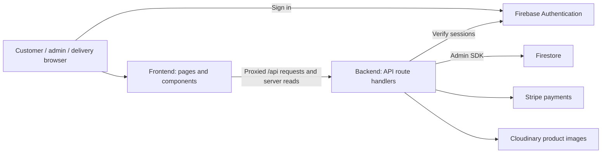

# System architecture

JOJO Store has separate frontend and backend Next.js applications on Vercel.

## Frontend

`frontend/src/app` contains pages and layouts, `src/components` contains UI,
`src/lib/backend` forwards authorized reads to the backend, and `src/lib/store`
contains cart state. Frontend configuration contains public settings only.

## Backend

`backend/server.js` starts the standard Next.js server for local development and
self-hosted production. Vercel builds API functions using the Next.js framework.

- `backend/src/app/api`: HTTP routes, input handling and responses.
- `backend/src/config`: Firebase Admin initialization.
- `backend/src/services`: authentication, payments, delivery and admin logic.
- `backend/src/lib`: shared access policies.
- `backend/src/types`: backend data types.

## Data and security

The backend verifies session cookies and checks ownership or staff permissions
before private reads and writes. Stripe secrets and Firebase Admin credentials
remain in backend configuration. Payment finalization updates orders, inventory
and payment-event markers atomically. Delivered orders appear in customer Order
History; unfinished orders remain in My Orders.

Firebase rules, indexes and emulator settings remain at the repository root.
Generated dependencies, builds and deployment metadata are ignored by Git.
